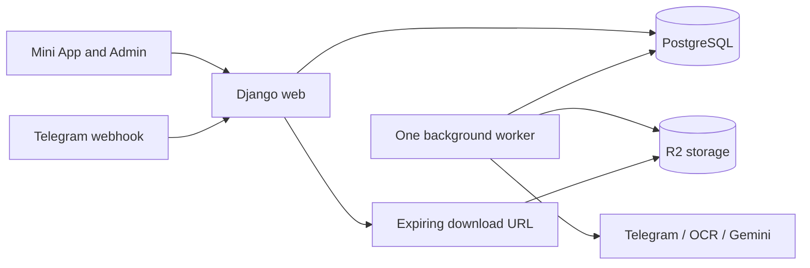

# UniPortal improvement roadmap

Created: 2026-10-08. Status: Phases 1–6 repository work implemented; production checks pending.

## Product direction

UniPortal is currently in an adoption period. Students should be able to enjoy
the app for free while they build familiarity with it. Free access is an
intentional product decision, not a defect to fix by introducing paywalls.

This roadmap does **not** activate premium restrictions, enforce a five-question
daily allowance, or restrict existing student access. Paid-access enforcement
is deferred until the owner decides to monetize. Existing subscription records
and payment workflows should still remain accurate.

Free access does not remove the need for valid authentication, ownership checks
on personal records, input validation, or limits on request size and processing
time. Those controls protect availability without imposing paid quotas.

## Working principles

- Keep Django, PostgreSQL, Django Admin, and one codebase.
- Use clear feature modules and explicit functions. Avoid generic service,
  repository, and abstraction layers without a concrete need.
- Finish and verify one phase before moving to the next. Prefer small changes
  within each phase so failures are easy to identify and roll back.
- Preserve student workflows. Coordinate API response changes with the frontend.
- Measure server demand before changing worker counts or buying infrastructure.
- Reuse existing processing records before introducing new job models.
- Add tests for meaningful business rules and failure scenarios, not every
  reversible cleanup.
- Do not add microservices, Kubernetes, another database, or a separate queue
  service unless measured requirements justify them.

## Review baseline

The initial review covered the backend code, configuration, deployment files,
and tests. It did not inspect the frontend, live infrastructure, bucket
visibility, production traffic, backups, or bills.

Observed locally:

- 85 tests ran: 80 passed and five storage tests failed.
- Storage tests expect file copies, while the implementation shares a stored
  object between inbox and resource records.
- An invalid question limit (`limit=abc`) returns HTTP 500.
- A mixed quiz with a correct MCQ and a pending essay returns 100% at submission
  but displays 50% through the saved attempt model.
- Serializing three resources with prefetched courses still executes eight SQL
  queries.
- OCR installs signal handlers even though the extraction path runs in a
  background thread, where signal registration raises `ValueError`.
- Webhooks await file processing; exam processing uses a temporary daemon
  thread; AI extraction and broadcasts run inside admin requests.
- Downloads pass through Django, and resource serializers can also return
  direct storage URLs.

Premium-answer access and inconsistent free-question allowances were identified
in the review, but paid restrictions are intentionally excluded from the active
phases following the owner's clarification.

## Phase 1 — Establish a reliable baseline

**Outcome:** Tests reflect intended behavior, operational assumptions are known,
and later changes can be assessed against a repeatable baseline.

- [x] Reconcile the five failing storage tests with the intended shared-object
  approach. Preserve the benefit of avoiding unnecessary file copies.
- [x] Verify that clearing an inbox reference preserves a published resource's
  file, and that duplicate cleanup deletes only unreferenced duplicates.
- [x] Add CI for the test suite, Django system checks, and migration drift checks.
- [x] Run relevant database tests against PostgreSQL, especially transactions,
  concurrency, constraints, and JSON filtering. Keep SQLite convenient locally.
- [ ] Record the actual deployment: hosting provider, CPU/RAM, web worker count,
  database placement, storage configuration, scheduled commands, and monthly bill.
- [ ] Capture baseline request latency, error rate, peak memory/CPU, slow queries,
  file-transfer traffic, and processing backlog using available hosting tools.
- [ ] Verify the existing database/media backup arrangements and perform a restore
  into an isolated environment. Add missing backups if necessary.
- [x] Document the intentional free-access policy; identify existing route
  restrictions that conflict with it before any access-related implementation.

**Completion checks:** Intended storage behavior passes; checks are repeatable;
PostgreSQL validation is available; deployment and restore procedures are
documented. Measurements are recorded without claiming unverified cost savings.

Primary files: `apps/content/tests.py`, `apps/content/services.py`,
`apps/api/tests.py`, `README.md`, deployment configuration.

**2026-10-08 progress:** 92 tests pass on isolated PostgreSQL 18.6; SQLite passes
90 with two database-feature tests skipped. Shared-file cleanup protects other
resource/inbox references. PostgreSQL exposed and verified the fix for a command
closing its caller's transaction. System checks, migration drift, dependency
consistency, and a synthetic database/media restore pass. CI targets Python 3.12
and PostgreSQL 15; its hosted execution is pending. Railway Hobby is confirmed
by the owner, but actual usage, costs, schedules, and a real restore remain
unverified. See [Phase 1 baseline and operations](docs/PHASE_1_BASELINE.md).

## Phase 2 — Fix correctness and validate requests

**Outcome:** Valid requests produce consistent results; invalid requests return
clear client errors; payment actions do not leave partial state.

- [x] Add focused DRF input serializers for question selection, quiz submission,
  and subscription requests. Validate types, modes, IDs, answer shapes, duplicate
  question IDs, and bounded per-request limits.
- [x] Validate that submitted questions belong to the requested quiz context;
  reject unknown IDs and inconsistent course/paper associations. Keep access free.
- [x] For simulation, retain the issued question set so omitted answers count as
  unanswered rather than disappearing from the denominator. Prevent duplicate
  completion of the same attempt without building a general session framework.
- [x] Store a consistent gradable-question denominator and pending-question count.
  Use them across submission feedback, history, pass status, and performance.
  Decide explicitly how older attempts will be displayed or backfilled.
- [x] Calculate historical topic performance from stored answer snapshots rather
  than the current, potentially edited question bank.
- [x] Make subscription approval one explicit transactional operation. Lock the
  request and student, check state, and make repeated approval harmless.
- [x] Review rejection of previously approved payments, including renewals, so
  subscription expiry remains consistent with the agreed business rule.
- [x] Notify only after commit. In Phase 3, move notification delivery to the
  durable worker so Telegram failure cannot block or undo payment state.
- [x] Use atomic database expressions for download counters. Define them as link
  issuance counts unless actual completed transfers are measured.
- [x] Remove the hardcoded `Course(pk=1)` publishing dependency. Keep unassigned
  resources pending until an administrator selects their actual course.

**Completion checks:** Invalid inputs return 400 rather than 500; mixed-question
scores agree everywhere; simulation scoring includes unanswered questions;
concurrent/repeated approvals cannot activate twice; existing free access works.

Primary files: `apps/api/views.py`, `apps/api/serializers.py`,
`apps/quiz/engine.py`, `apps/quiz/models.py`, `apps/accounts/admin.py`,
`apps/accounts/models.py`, `apps/content/admin.py`.

**2026-10-08 progress:** Repository implementation verified. PostgreSQL passes
all 113 tests; SQLite passes 108 with five skipped. Coverage includes concurrent payment transitions, simulation completion,
and download increments. Input validation, historical scoring, and pending-only
rejection are covered. See [Phase 2 correctness](docs/PHASE_2_CORRECTNESS.md) for
API compatibility, migration and rollout details. Production/frontend checks
remain pending; notifications become durable in Phase 3.

## Phase 3 — Make background work durable

**Outcome:** Web requests remain short, and processing survives worker restarts
with controlled retries.

Start with one separate worker process using PostgreSQL-backed pending work.
Reuse `FileInbox` and `ExamPDFUpload` where appropriate. Add small durable records
for webhook acceptance and notification/AI work only where existing records
cannot represent the required lifecycle.

- [x] Save and deduplicate accepted Telegram updates before returning success.
  Acknowledge only after persistence succeeds; do not discard failures to avoid
  retries.
- [x] Move file download/extraction, exam PDF processing, AI extraction,
  broadcasts, and payment notifications out of web requests and daemon threads.
- [x] Claim pending work atomically. Store claim time, retry count, next retry
  time, and the last error where needed.
- [x] Recover only stale claims. Use bounded retries with backoff, and leave
  permanently invalid files visible for administrator review.
- [x] Replace the current recovery-only `run_bot` deployment role with a clearly
  named worker command; keep one-off recovery commands explicit.
- [x] Replace OCR signal alarms with supported subprocess/library timeouts.
  Bound page rendering, total processing time, and concurrent extraction.
- [x] Report empty, skipped, and partially extracted documents accurately.
- [x] Use unique temporary download paths, sanitize supplied filenames, and
  remove temporary files in `finally`.
- [x] Handle Telegram rate limits and retry delivery failures. Persist broadcast
  progress so a restart does not resend every delivered message.
- [x] Cache completed AI extraction by source content and extraction version;
  bound input/output size, validate generated questions, and avoid repeated paid
  extraction for identical inputs. Keep human review before publication.
- [x] Schedule periodic commands explicitly and document their ownership.

**Completion checks:** Webhook acceptance is quick and durable; killing and
restarting the worker recovers unfinished work; duplicate updates do not create
duplicate content; OCR works in the chosen execution model; retries are bounded;
admin pages show useful progress and errors.

Primary files: `apps/api/views.py`, `apps/bot/application.py`,
`apps/bot/handlers.py`, `apps/bot/tasks.py`, `apps/bot/processor.py`,
`apps/bot/downloader.py`, `apps/bot/extractor.py`, `apps/exams/admin.py`,
`apps/exams/management/commands/process_exam_pdfs.py`,
`apps/accounts/notifications.py`, `Dockerfile`, `docker-compose.yml`, `Procfile`.

**2026-10-08 progress:** Durable PostgreSQL work records and a single worker
replace webhook processing and admin/daemon-thread work. PostgreSQL passes all
134 tests, followed by 36 focused worker/exam checks; SQLite passes 128 of
135 with seven skipped. Backup/restore and actual child
interruption/recovery drills pass. Real OCR smoke execution is pending hosted CI
because local Tesseract is unavailable. See [Phase 3 background work](docs/PHASE_3_BACKGROUND_WORK.md)
for limits, delivery semantics, model configuration, and Railway rollout. The
live worker, scheduler, and provider smoke checks remain pending.

## Phase 4 — Reduce file-delivery and memory costs

**Outcome:** File transfers avoid consuming Django workers, and file handling
fits the available memory budget.

- [ ] Check actual R2 bucket visibility and the frontend's preview/download flow.
- [x] Return short-lived R2 presigned URLs for downloads, allowing current free
  access under the adoption policy. Private storage is a delivery control, not
  permission to introduce a paywall.
- [x] Replace permanent object URLs in serializers where the frontend needs a
  controlled preview/download URL; coordinate this before changing visibility.
- [ ] Preserve filenames, content types, link expiry handling, and browser CORS.
  Verify representative large files and mobile Telegram downloads.
- [x] Retain a working local-development download path.
- [x] Lower the in-memory upload threshold and add explicit size/type validation.
  The memory threshold itself is not a maximum permitted file size.
- [x] Bound PDF page count/rendering and eliminate the unbounded all-page OCR
  fallback. Avoid treating a large digital PDF as necessarily expensive OCR.
- [x] Move legacy duplicate-file cleanup into scheduled maintenance rather than
  running storage checks in the ingestion path.
- [x] Define safe orphan cleanup and retention for temporary files, failed
  uploads, and obsolete extraction data. Protect every referenced stored object.
- [ ] Compare application bandwidth, memory, worker occupancy, and storage
  operations against the Phase 1 baseline.

**Completion checks:** Downloads work under the free-access policy; file bytes
flow directly from R2 in production; preview behavior remains usable; cleanup
preserves referenced files; measured server demand is recorded.

R2 presigned URLs use the S3 API endpoint and do not support custom domains
directly: [Cloudflare documentation](https://developers.cloudflare.com/r2/api/s3/presigned-urls/).

Primary files: `apps/api/views.py`, `apps/api/serializers.py`,
`apps/content/services.py`, `config/settings/base.py`,
`config/settings/docker.py`, `config/settings/prod.py`.

**2026-10-13 progress:** Owner confirms private R2 (public access disabled).
R2 downloads/previews now use 15-minute signed URLs without opening file bytes;
local and legacy links remain supported. Published resource access is free during
adoption. Upload bounds, protected orphan auditing, and reviewed work compaction
are implemented. See [Phase 4 file delivery](docs/PHASE_4_FILE_DELIVERY.md).
PostgreSQL passes all 144 tests; SQLite passes 137 with seven skipped.
Checks and a synthetic database/media restore pass. Actual frontend/mobile/CORS
behavior, Phase 3 rollout, and measured Railway impact remain open.

## Phase 5 — Make database and API work proportional to demand

**Outcome:** Common endpoints avoid repeated queries and unbounded object loads.

- [x] Use prefetched course objects in resource serialization instead of
  `values_list()` queries on each resource.
- [x] Load related courses, departments, and chapters with the relevant queries.
  Annotate question counts instead of recounting for each serialized object.
- [x] Add explicit pagination to growing list endpoints. Coordinate response
  shape changes and incremental rollout with the frontend.
- [x] Bound question-selection requests without imposing paid daily allowances.
  Filter in PostgreSQL and fetch only the selected full question records.
- [x] Make selective practice use database filtering; keep chapter and topic
  semantics explicit before changing their representation.
- [x] Aggregate performance in SQL and fetch only the required recent history.
  Avoid per-answer question lookups.
- [x] Parse and validate exam imports before writing. Add domain uniqueness
  constraints, define correction/re-import behavior, and use bounded batch writes
  and transactions to prevent partial imports.
- [x] Review slow queries with PostgreSQL query plans. Add justified indexes and
  remove redundant indexes, rather than indexing every field.
- [x] Identify authenticated throttling by student ID. Review proxy/IP handling
  for anonymous endpoints and make multi-worker limits consistent where required.
  Operational throttles remain separate from monetization quotas.
- [x] Cache small, frequently reused catalogue responses only if measurements
  justify it. Define invalidation before adding a cache service.

**Completion checks:** Query counts remain bounded as lists grow; list responses
and selections have explicit limits; import retries do not duplicate records;
performance latency improves against the baseline; PostgreSQL checks pass.

DRF throttles use cache-backed, non-atomic operations and are approximate; do not
use them as exact entitlement accounting:
[DRF documentation](https://www.django-rest-framework.org/api-guide/throttling/).

Primary files: `apps/api/views.py`, `apps/api/serializers.py`,
`apps/api/throttles.py`, `apps/quiz/engine.py`, `apps/exams/services.py`,
domain models and migrations.

**2026-10-13 progress:** Prefetch reuse, related-object loading/count annotations,
opt-in pagination with bounded legacy lists, SQL topic selection/performance,
validated atomic PDF/CSV imports, identity constraints, and student-aware
throttling are implemented. Auth/payment histories use the existing database;
catalogue caching was not justified. Two indexes are supported by local query
plans. Resource serialization stays at two queries for 3 or 30 rows. PostgreSQL
verified 165 distinct tests; SQLite passes 157 with eight skipped. Restore and
checks pass. See [Phase 5 database/API work](docs/PHASE_5_DATABASE_API.md) for
synthetic measurements, migration conflicts, and frontend/proxy rollout.
Production latency/cost and live integration remain unverified.

## Phase 6 — Simplify code and production operation

**Outcome:** Responsibilities are easy to locate, deployment is predictable, and
the server is sized from evidence.

- [x] Split the large API view file into feature modules while preserving URLs
  and response contracts. Keep views, serializers, and explicit domain functions
  easy to follow.
- [x] Remove unreachable duplicated extraction code and caller-stack inspection.
  Payment authorization should be enforced by explicit code paths and state.
- [ ] Consolidate production settings while keeping local development convenient.
  Require production secrets, remove known fallback secrets, and verify secure
  cookies and trusted reverse-proxy settings against the actual deployment.
- [x] Require the production webhook secret and restrict ingestion to configured
  source channels. Account for source chat IDs in deduplication if multiple
  channels are supported.
- [x] Require valid Telegram authentication timestamps, reject excessive future
  timestamps, and review token lifetime with frontend reauthentication behavior.
- [x] Run migrations once per release. Prepare static assets ahead of process
  startup where practical, and document rollback limitations for migrations.
- [x] Configure database connection reuse consistently with worker concurrency.
  Add connection pooling only if measured connection pressure warrants it.
- [x] Make health checks execute a small database query; expose worker backlog
  and stale-job status separately from web liveness.
- [ ] Add request/job identifiers and alerts for sustained API errors, worker
  failures, backlog growth, disk usage, and failed backups. Keep logs bounded and
  avoid logging tokens or unnecessary student/document content.
- [x] Review dependency pins and remove packages only after checking usage.
  Keep security updates and supported versions deliberate.
- [ ] Tune Gunicorn worker count and background concurrency using realistic
  traffic and extraction workloads. Compare costs and latency with Phase 1.
- [x] Update `README.md`, `PROJECT.md`, and `docs/ARCHITECTURE.md` to reflect the
  implemented deployment and remove obsolete descriptions.

Repository details, verification and deployment instructions:
[Phase 6 operations](docs/PHASE_6_OPERATIONS.md),
[dependency audit](docs/PHASE_6_DEPENDENCY_AUDIT.json), and
[synthetic web comparison](docs/PHASE_6_WEB_BENCHMARK.json).
The shared production settings and secure cookie defaults are implemented;
actual proxy/TLS verification remains pending. Request/job IDs, sanitized console
logs and read-only queue/disk/backup checks are implemented; connecting an alert
receiver remains pending. A local worker-count comparison supports documenting
the memory/latency tradeoff; production traffic, OCR memory and bills still need
measurement before final sizing or verified savings. No paid gates were added.

**Completion checks:** Deployment checks pass with actual production settings;
restart/deploy and restore procedures work; code is simpler to navigate; latency,
resource usage, and cost comparisons are documented.

## Admin improvement track — audit and implementation order

Audited 2026-10-15. This is a separate admin improvement track, not a declaration
that the original production rollout checks are complete. Investigation covered
admin registrations, custom views, templates, worker recovery, isolated Django
requests and read-only production aggregates. No production records were changed
or jobs retried. Visual findings below are from template inspection; browser,
keyboard, narrow-screen and contrast checks remain part of implementation.

### Production snapshot

At 07:20 UTC on 2026-10-15:

| Area | Observed state | Interpretation |
|---|---|---|
| Exam PDF imports | 55 processed; 14 failed | All failed uploads date from 2026-09-14 and have attempt count zero. Error text falls in the PDF parsing category; review individual causes before retrying. These predate the durable-worker rollout and do not establish that the new worker failed. |
| File inbox | 276 processed; 2 unprocessed | Earliest pending due time was 2026-10-14 21:39 UTC, about 9 hours 41 minutes overdue. Verify worker deployment, eligibility and logs before promising recovery. Processed does not necessarily mean unassigned or published. |
| Telegram updates, notification deliveries, AI extractions | No rows | An empty queue is not proof that ingestion or the worker is operating. |
| Stale processing claims | Zero across the five queues | No processing claim exceeded the configured 15-minute threshold at inspection. |
| Published resources without courses | Zero | Publishing should still validate course assignment to prevent future mistakes. |

### Findings

| Priority | Problem and evidence | Improvement |
|---|---|---|
| P0 | Custom admin views rely on staff access without checking model permissions. In an isolated database, a staff user with no model permissions received 403 on the normal resource list, 200 on audit/broadcast/upload pages, and successfully deleted a synthetic resource through the custom URL. See [custom resource views](apps/content/views_admin.py), [broadcast](apps/accounts/admin.py), [exam actions](apps/exams/admin.py), and [quiz actions](apps/quiz/admin.py). | Apply explicit view/add/change/delete permissions to each custom operation and its UI control; test restricted staff as well as superusers. |
| P0 | Resource duplicate cleanup groups solely by normalized title and deletes Resource rows. Equal titles do not establish equal files; deleting a shared resource also removes its other course links. See `delete_duplicate_resources` in [resource views](apps/content/views_admin.py). | Replace automatic title-based deletion with candidate review. Show file identity, course associations and the exact proposed deletion/unlink action before confirmation. |
| P1 | File inbox declares `retry_failed_extraction`, but that method is defined on ResourceAdmin instead. Django action lookup returned no action for FileInboxAdmin. See [content admin](apps/content/admin.py). | Put the retry on the correct admin; report queued and skipped counts and preserve review-before-retry behavior. |
| P1 | Failure queues are registered under Bot but omitted from the configured sidebar while all-applications navigation is hidden. The inbox success message directs users to this missing Bot section. See [navigation](config/settings/base.py) and [job admin](apps/bot/admin.py). | Add a permission-aware Operations section and direct links from files/imports/broadcasts to their jobs and errors. |
| P1 | The homepage has no project-specific overview template or dashboard callback. Only payment requests get a sidebar count. | Make pending reviews, overdue work and failures visible before totals. Each count should open the corresponding filtered list. |
| P1 | Course coverage treats any resource, including pending/rejected, as coverage. An isolated course with one pending resource showed 100% coverage and zero published resources. Department reporting hardcodes distance programs and can count repeated course placements as separate courses. See [audit queries](apps/content/views_admin.py). | Define coverage as published student-visible material; count distinct active courses; make program/department scope explicit and consistent with filters. |
| P1 | “Publish selected as Resource” actually creates pending drafts without courses; “Mark selected as processed” can bypass extraction and reports all selected rows rather than only changed rows. See [inbox actions](apps/content/admin.py). | Name draft creation accurately, link to the created drafts, and show the next required step. Remove or clearly distinguish manual processing overrides. Report actual changed/skipped counts. |
| P1 | Exam upload polling is disabled on the global upload page because there is no term ID. On term pages it refreshes counts but not table rows/errors, has no fetch failure feedback, and checks four counts per request. The Process button only reports queue state; it does not start work. See [upload template](templates/admin/exams/upload_pdfs.html) and [exam admin](apps/exams/admin.py). | Show one consistent queued/processing/completed/failed flow on both pages; refresh visible results, report connection failures, and remove the redundant Process action. Use one aggregate query and bounded polling while work is active. |
| P1 | Quiz bulk metadata uses unchecked IDs and raw posted values with `queryset.update()`. Missing objects can raise errors; chapter/paper consistency and choice validation are absent from this flow. Selection is stored under one session key, so a second tab can replace the first selection. See [quiz admin](apps/quiz/admin.py). | Use a validated Django form and explicit selection per operation. Show a preview/count and retain valid input on errors. |
| P2 | Lists expose many columns and relationship dropdowns; course/paper/chapter selection gets harder as content grows. Several computed counts execute a query per displayed row (exam terms, papers, chapters), and the audit runs queries per department without pagination. | Keep task-relevant columns, add searchable relation inputs, annotate counts, paginate audit lists and measure query counts against realistic data. |
| P2 | Custom bulk updates/deletes bypass the standard per-object admin change logging. Job records appear read-only but still inherit delete capability for users with delete permission. | Log meaningful custom changes; prevent routine deletion of operational history where it would hide failures or remove queued work. |
| P2 | Templates mix Unfold utilities, large copied CSS blocks, inline styles and hardcoded dark backgrounds. Several wide tables use overflow-hidden. The broadcast timestamp expression spans lines and an isolated render left the expression literal. | Use existing Unfold styles consistently; fix the timestamp, table scrolling, light/dark states, focus visibility, labels and empty/error states. Verify in a browser before calling accessibility complete. |
| P2 | Broadcast confirmation exists, but the confirmed button submits without a duplicate-submit guard and the POST has no operation token. Repeated submissions create separate broadcasts; history offers no direct delivery-error recovery link. | Prevent accidental repeated sends, make recipient count clear, and link delivery progress/failures to Operations. Keep delivery in the existing worker. |

### Intended navigation and homepage

Keep Django + Unfold and the current monolith. Use six clear destinations:
Overview; Content; Exams & quizzes; Students & communication; Operations;
Settings. Keep payments available under Students without making monetization
the focus or changing free student access. Model-specific subpages remain normal
Django admin pages, with descriptive labels and permission-aware links.

The Overview should answer “What needs my attention?” with clickable counts for
failed imports, failed extraction/delivery, overdue pending work, draft resources
needing review and unassigned questions. Counts with overlapping populations must
not be added into a misleading grand total. Provide shortcuts for reviewing
uploads, creating a resource, uploading exam PDFs and finding a student. Add the
active exam term and a small recent-activity list with timestamps and links.
Do not label the worker healthy merely because queues are empty; display what
was actually observed and when.

### Step-by-step delivery

1. **Safety and recovery correctness.** Fix custom permissions, title-based
   duplicate deletion, the missing inbox retry action and misleading action
   messages. Inspect historical PDF failures and overdue inbox work; verify the
   worker before explicitly retrying eligible records. Add targeted regression
   tests for denied access and state changes. Complete when restricted staff
   cannot mutate unauthorized records and legitimate recovery is available.
2. **Navigation and Overview.** Add the grouped sidebar, task shortcuts,
   permission-aware attention cards and linked status summaries. Complete when
   common tasks and failure queues are reachable from the homepage and every
   card opens the matching filtered records. Keep queries bounded; no external
   calls, object reads, or constant polling on the homepage.
3. **Content workflow.** Make inbox -> draft -> course assignment -> review ->
   publish explicit. Improve relation search, preview/details, coverage accuracy,
   empty states and paginated audit lists. Complete when an admin can finish this
   flow without guessing the next screen and titles never authorize deletion.
4. **Exams, questions and communication.** Repair upload progress/results,
   validate bulk edits, preserve selections safely and expose delivery recovery.
   Complete when global and term-specific uploads show accurate terminal results,
   invalid edits return helpful errors and broadcasts resist accidental repeats.
5. **Usability and cost verification.** Check narrow screens, keyboard navigation,
   light/dark themes, table overflow and back/filter preservation. Measure query
   growth and page response times on representative data; fix measured hotspots
   with concrete queries. Do not add a separate admin frontend, new service,
   generic dashboard framework, Redis, charts library or broker for this work.

### Step 1 implementation — 2026-10-15

Repository safety and recovery changes are implemented and locally verified:

- Custom audit, resource deletion, broadcast, exam activation/upload/status,
  question import/template and bulk metadata routes now check the relevant model
  permissions. Mutating admin actions require change permission. Draft creation
  additionally requires resource-add permission; AI extraction requires
  question-add permission. Related custom-page controls are hidden when forbidden.
- Title-based bulk deletion no longer deletes records. Individual deletion uses
  Django's related-object confirmation and normal deletion log. Resource review
  shows file references and course associations, with titles labeled as possible
  duplicates rather than proof of identical contents.
- Inbox retry now exists on FileInboxAdmin, requeues only failed, unassigned
  records with file references, resets claim/attempt state and reports skipped
  records. PDF/job retries report skipped non-failed records. Routine job/PDF
  history deletion is disabled, including for superusers.
- Draft creation is labeled accurately; manual processing is explicitly described
  as an override that does not extract text. Resource update messages use affected
  row counts, including when the original selection was filtered by status.

Verification: 12 new admin regression tests cover restricted staff, legitimate
access, confirmation/logging, shared resource preservation, action permissions
and mixed retry selections. The full SQLite suite ran 209 cases: 201 passed and
8 PostgreSQL-only cases skipped. Django checks and migration-drift checks pass;
no migration is required. No production records were changed or jobs retried.

**Operational follow-up remains open:** read-only Railway inspection on
2026-10-15 found only `web` and `Postgres`, with no worker service. Deploy the
existing `railway-worker.json` configuration and verify bounded processing before
retrying reviewed historical failures. The queue snapshot above remains a point
in time, not a claim that those jobs have recovered. The 14 historical import
errors still require individual source/error review before retrying.

### Step 2 implementation — 2026-10-15

Navigation and Overview are implemented in the existing Django/Unfold admin:

- Grouped navigation covers Overview, Content, Exams & quizzes, Students &
  communication, Operations and Settings. Standard destinations use their
  registered admin permissions; unavailable destinations and empty groups are
  omitted. Staff accounts/groups and previously hidden work queues are reachable.
- Overview shortcuts cover inbox review, resource creation, exam PDF upload and
  student search. Attention cards link to pending drafts, extracted unassigned
  files, unassigned questions and nonzero failed/overdue/stale job counts.
- A shared admin filter keeps all five job queues consistent with their counts.
  Inbox operations explicitly include assigned files, avoiding the inbox's default
  hidden-assignment filter. Overdue means pending for more than 15 minutes;
  stale means processing with a missing claim or a claim older than the configured
  worker timeout. No overlapping categories are combined into a grand total.
- The active exam term and six most recent recorded admin changes are shown
  only for models the user can view. Deleted activity entries have no edit link.
  The page explains that bulk/background actions may not appear in this history.
- The page shows its snapshot timestamp and explicitly states that queue counts
  do not prove worker health. There is no polling, external call, storage read,
  new service, chart package or new dependency. A scoped stylesheet supplies the
  spacing, warning, keyboard-focus and screen-reader utilities missing from the
  bundled Unfold CSS; the queue table scrolls horizontally on narrow screens.

Verification: eight new tests cover linked record counts across queues, assigned
inbox failures, scheduled/future jobs, stale claims, restricted staff, sidebar
destinations, recent-activity privacy, active terms and query growth. The full
SQLite suite ran 217 cases: 209 passed and 8 PostgreSQL-only cases skipped.
Dashboard data uses 10 queries for a superuser both before and after adding 100
jobs (the complete HTTP request also has normal admin/session/permission queries).
Migration-drift checks pass; no migration is needed. Static collection includes
the new stylesheet. Browser visual verification remains pending because the
available Chromium executable lacks system libraries in this environment.

The worker deployment follow-up from Step 1 remains open. This step does not
retry or alter production work.

### Step 3 implementation — 2026-10-15

The content workflow is implemented and verified in the existing admin:

- Inbox and resource pages explain the next action. Creating a single draft
  opens its review form; a batch opens a list filtered to the created drafts.
  Repeated selections preserve the original assignment and skip ineligible
  records. Draft creation and assignment are recorded in admin history. Assigned
  inbox records remain hidden from the default list but their detail pages are
  accessible, with a link to the resource. Assignment is read-only in the inbox.
- Resource forms use searchable course selection. New choices are active courses;
  existing inactive assignments remain visible for older drafts. Placement forms
  also use searchable course/department inputs. Staff need the related model's
  normal view/change permissions to use Django's relation search.
- Review links open private R2 files using the existing expiring signed delivery
  code, without downloading their bytes through the web service. Local file
  previews stream only after an explicit authorized request. Stored size/page
  metadata is visible without reading the file on the review page.
- Publishing through the resource form requires a file reference and at least
  one active course. Status is no longer editable directly in the list. Bulk
  publishing accepts reviewed pending drafts that meet the same requirements,
  reports skipped records and logs changes. It locks resource rows through a
  separate ID subquery so related-course searches using DISTINCT work on
  PostgreSQL. These checks verify assignment and stored file references, not
  physical object availability; the explicit file review remains necessary.
- Draft filters distinguish missing active-course assignments from files ready
  for review. Drafts can remain unassigned while being prepared. Free student
  access and existing monetization behavior are unchanged.
- Coverage now counts distinct active courses with published material. All
  summary figures, department cards and lists share search, department and
  program scope; department/program must match the same placement. Repeated
  placements and shared resources are counted distinctly within each summary.
  All-program reporting replaces the hardcoded distance-only view. Unfiltered
  coverage includes active courses without placements, with an explanation.
- Department cards, course coverage lists and per-course resources are paginated.
  Coverage navigation uses normal links and keeps filters while changing pages
  or views. Invalid tab values cannot break client-side navigation. Matching
  resource titles remain review-only hints across page boundaries; they never
  authorize automatic deletion. Tables scroll horizontally on narrow screens.

Verification: 16 new regressions cover single/batch draft handoff, repeat safety,
publication rules/logging (including course-search locking), inactive assignments,
autocomplete, review filters, authorized local/R2 preview, published coverage,
placement scoping, search, pagination and bounded department query growth.
The complete suite passes on an isolated temporary PostgreSQL database: 233
tests passed. SQLite: 225 passed and 8 PostgreSQL-only cases skipped. System and
migration-drift checks pass; no migration is required. Static collection includes
the workflow stylesheet. The department overview query count stays bounded when
30 departments are added; each page renders at most 24 departments or 25 courses
or resources. Visual browser verification and the existing worker rollout remain
pending. No production records or jobs were changed.

### Step 4 implementation — 2026-10-15

Exam progress, question bulk editing and broadcast feedback are implemented:

- Global and term upload pages now use the same status flow. Status requests
  aggregate counts in one query and optionally return the latest 50 file rows,
  including terminal errors and created/updated counts. The old four-count JSON
  response is preserved when details are not requested. The redundant Process
  button is removed; its legacy POST remains a harmless explanatory redirect.
  Upload limits reflect configured settings, and failed imports link to their
  full detail/retry controls. The upload page now supports light/dark themes and
  horizontal table scrolling without the previous copied dark-only layout.
- Upload and broadcast status refreshes stop when displayed work finishes or
  after 24 requests at five-second intervals. Hidden pages pause refreshing;
  requests have a ten-second deadline. Connection/session errors are visible and
  manual refresh restarts checking. File names/errors are inserted as text, not
  HTML. Queue snapshots still do not claim worker health.
- Each question bulk form carries an independently signed, user-bound selection
  that expires after an hour. Selections no longer share a session key across
  tabs. Both paper assignment and metadata actions use the same validated form.
  Invalid IDs, choices and overlong year labels keep their form input and apply
  no changes. Existing and proposed paper/chapter assignments are checked for
  course consistency across the whole selection before an atomic update.
  Removing a chapter is explicit; missing/deleted selection members block partial
  edits. Choices respect related-model permissions, and applied edits are logged.
  The unused assignment template and duplicated bulk CSS were removed.
- Broadcast forms show the current active-recipient count, preserve invalid
  message input and require a signed, user-bound confirmation. A unique nullable
  submission token on BroadcastMessage makes repeat/concurrent submissions of
  that form reuse the same broadcast and deliveries. Reusing a token for different
  content is rejected; a fresh form permits a deliberate new broadcast. Existing
  internal callers without a token retain their behavior. The button guard also
  prevents repeated clicks while submitting.
- Broadcast history refreshes delivered/remaining/failed counts, shows correctly
  rendered timestamps, and links permitted staff to the matching failed delivery
  records. Staff who can compose but cannot view general broadcast history see
  only their own broadcasts. Recovery remains the reviewed retry action on the
  durable delivery queue; no whole-broadcast resend is triggered automatically.

Verification: 19 new tests cover scoped upload progress and bounded rows, bulk
validation, independent/invalid/cross-user selections, related-model permissions,
atomic relationship checks, repeated broadcasts, history visibility and actual
concurrent broadcast creation on PostgreSQL. Full PostgreSQL suite: 252 passed;
SQLite: 243 passed and 9 PostgreSQL-only cases skipped. JavaScript syntax and
isolated execution checks passed for text-only rendering, terminal refresh,
connection errors, the 24-request limit and duplicate-submit guarding. Static
collection includes both scripts; system checks, migration-drift and diff checks
pass. Final focused upload/bulk-edit checks also pass.

**Deployment:** apply `accounts.0009_broadcastmessage_submission_token` before
serving this version. It adds a nullable unique UUID column; existing broadcasts
receive NULL, with no exam-data migration or cleanup. Do not regenerate a new
token automatically when retrying a submitted form. Browser visual verification,
live Telegram flows and worker rollout verification remain pending. No production
jobs or records were changed during this work; no new dependency/service or paid
access gate was introduced.

### Step 5 implementation — 2026-10-15

Usability and query-cost fixes are implemented and verified on synthetic data.
Measured results and browser checks are saved in
[ADMIN_VERIFICATION.json](docs/ADMIN_VERIFICATION.json). Reproduce the isolated
SQLite measurements with `venv/bin/python scripts/check_admin_performance.py`;
the script explicitly disables .env and uses a new in-memory test database.

Rendered list-page SQL queries with 25 synthetic rows, including normal admin
and session overhead:

| Page | Before | After | After with one row |
|---|---:|---:|---:|
| Overview | 14 | 14 | 14 |
| Exam terms | 56 | 6 | 6 |
| Exam papers | 57 | 7 | 7 |
| Chapters | 32 | 6 | 6 |
| Questions | 110 | 6 | 6 |
| Students | 32 | 7 | 7 |
| Payment requests | 32 | 7 | 7 |
| Message deliveries | 32 | 6 | 6 |

- Term totals use separate correlated counts, avoiding both per-row round trips
  and a student-by-PDF join multiplication. Papers/chapters annotate active
  question counts; nullable relationships are fetched with their lists. Selected
  relationship filters use Unfold's existing autocomplete instead of rendering
  every possible chapter/course/broadcast. No cache or new dependency was added.
- Resource review, coverage/course-detail pagination and question bulk edits
  preserve their original search/filter scope on return. Return destinations
  remain fixed local admin routes; arbitrary next URLs are not carried through.
- Browser checks exposed unnamed list-edit checkboxes and generated Select2
  controls. A small admin script supplies contextual labels, including after
  Select2 replaces its controls. Native buttons replace the header/navigation
  group's click-only spans/headings. Expanded state is announced; mobile opening
  moves focus into navigation, and Escape closes it and restores toggle focus.
- The primary blue was adjusted after measuring insufficient white-button text
  contrast (4.10:1). The rendered checked button now measures 4.77:1. Focus
  indicators, checkbox spacing and refresh-control targets were improved. The
  broadcast confirmation dialog has an explicit name/description and begins on
  Cancel. Three small Unfold template overrides preserve the installed layout;
  review them and repeat the browser checks when upgrading the pinned theme.

Verification: all 259 PostgreSQL tests pass; SQLite passes 250 with 9
PostgreSQL-only skips. Seven new tests cover query growth, accurate aggregate
counts, searchable filters, fixed local return routes and template controls.
Final focused checks pass after the native navigation changes. Real Chromium
checks covered eight pages at 390px/1280px in light/dark themes (32 combinations),
with zero page-wide overflow, unnamed tested form controls or script exceptions.
Keyboard checks verified focus indicators, Enter activation of navigation groups,
mobile menu focus/Escape restoration, and named broadcast dialog cancellation.
Static assets were served from an isolated collected-static directory; migration
drift and diff checks pass. This step requires no migration.

These are local checks, not an exhaustive accessibility certification or evidence
of production savings. Timings in the JSON are warm medians of three requests;
they do not establish Railway capacity, load latency or lower monthly bills.
No production records/jobs were changed. Live worker/Telegram/R2 verification,
real-device checks and the original production backup/alert/sizing follow-ups
remain open. The Step 4 broadcast-token migration is still required when deploying
from a version older than that change.

All five admin steps now have repository implementations and recorded checks.
The remaining work is production rollout/integration verification and any issues
found through actual administrator use; monetization remains deferred.

### Production rollout checkpoint — 2026-10-15

- [x] PR #90 merged; hosted container, SQLite and PostgreSQL checks passed.
- [x] Current admin code deployed successfully on Railway; required migrations
  present, health/liveness/catalogue/admin login return HTTP 200.
- [x] One durable worker deployed from matching `prod` commit, with no public
  endpoint or migration step. Both overdue inbox files were claimed and failed
  once at the existing 100-page extraction limit; review is required.
- [x] Private R2 signed reads now return the frontend CORS origin and range headers.
  Telegram reports a configured webhook with no backlog or last error.
- [ ] Verify a successful live upload/extraction, controlled notification and AI
  workflow, authenticated admin changes and frontend/device resource viewing.
- [ ] Verify full production backups and isolated restore, then deploy daily
  maintenance after reviewing its subscription/reminder/file-cleanup effects.
- [ ] Complete alerts, proxy trust and representative cost/capacity measurements.
- [ ] Migrate legacy Railway JSON configuration before the 2026-12-01 cutoff.
  New services already reject legacy config paths; the worker uses explicit
  equivalent service settings, while existing web retains `/railway.json`.

Details and measurement limits: [rollout evidence](docs/PHASE_6_OPERATIONS.md#admin-rollout-and-worker-activation--2026-10-15)
and [sanitized snapshot](docs/PRODUCTION_ROLLOUT_VERIFICATION.json). No extraction
limits were raised, failed jobs retried or monetization rules changed.

### Backup and maintenance implementation — 2026-10-15

Railway rejected native backup scheduling on this Hobby workspace because it
requires Pro. The owner selected the existing private R2 bucket for now, accepting
that it does not protect against bucket/account loss. Added a PostgreSQL snapshot
dump, incremental verified media copies and private completion manifests, with
30-day retention scoped to the new backup namespace. Daily maintenance must use
`run_maintenance --backup`; a failed backup prevents all maintenance effects.
The container now has PostgreSQL client 18, matching the production server.

Validation: 271 PostgreSQL tests pass; the container passes 271 tests with 11
PostgreSQL-only skips, dependency checks and real OCR. Twelve backup tests cover
actual dumps, missing files, corrupt copies, retention, credentials and ordering.
The real production backup/restore and cron rollout are being verified before
marking this checkpoint complete. No migration or Python dependency was added.
See [backup operation and recovery](docs/PRODUCTION_BACKUPS.md).

## Deferred — Monetization readiness

This section is inactive until the owner explicitly decides to introduce paid
access. Do not treat it as the next automatically authorized implementation phase.

- [ ] Agree on what remains free, what becomes paid, and how existing students
  transition. Document the product rules before changing endpoints.
- [ ] Enforce the agreed access policy consistently across question issuance,
  quiz submission, previews, downloads, and feedback.
- [ ] If daily allowances are introduced, track quiz usage separately from
  downloads and consume allowances atomically.
- [ ] Test free, paid, expired, inactive, and renewed account behavior, including
  attempts to bypass restrictions through alternative endpoints.
- [ ] Verify that permanent storage URLs cannot bypass the chosen access policy.
- [ ] Coordinate frontend messaging, migration, and rollout with the owner.

## Target architecture

One Django codebase with a web process, one background worker, PostgreSQL, and R2.
The web process handles authentication, validation, short database operations,
durable webhook acceptance, and download URL issuance. The worker handles slow
or retryable external work. Students download directly from storage.

## Tracking progress

For each phase, record the implementation date, changes, validation results,
measured impact, and remaining issues here. Check an item only after its behavior
has been verified. If a finding changes after production inspection, update the
roadmap rather than implementing an outdated assumption.

| Phase | Status | Validation / impact |
|---|---|---|
| 1 — Baseline | Repository work verified; production checks pending | 92 PostgreSQL tests; SQLite 90 passed / 2 skipped; synthetic restore passed. See docs/PHASE_1_BASELINE.md. |
| 2 — Correctness | Repository work verified; rollout pending | 113 PostgreSQL tests pass; SQLite 108 passed / 5 skipped; checks and synthetic restore recorded in docs/PHASE_2_CORRECTNESS.md. |
| 3 — Background processing | Repository implementation verified; rollout and OCR smoke pending | 134 PostgreSQL tests + 36 final focused checks; SQLite 128 passed / 7 skipped; recovery and restore drills pass. See docs/PHASE_3_BACKGROUND_WORK.md. |
| 4 — File delivery | Repository implementation verified; live integration and measurements pending | 144 PostgreSQL tests; SQLite 137 passed / 7 skipped; restore/checks pass. See docs/PHASE_4_FILE_DELIVERY.md. |
| 5 — Database and API efficiency | Repository implementation verified; rollout pending | 165 distinct PostgreSQL cases; SQLite 157 passed / 8 skipped; query plans and restore pass. See docs/PHASE_5_DATABASE_API.md. |
| 6 — Code and production operation | Repository, hosted CI, production web and worker deployment verified; remaining operational checks pending | Original baseline: 182 PostgreSQL tests and real container OCR. Current admin suite: 259 PostgreSQL tests; hosted SQLite/PostgreSQL/container checks pass. On 2026-10-15 current web/schema and one worker deployed; live endpoints and R2 CORS reads pass. Both overdue inbox files require review at the 100-page limit. Maintenance, full backups/restore, controlled integration flows, alerts, proxy trust and sizing remain open. See docs/PHASE_6_OPERATIONS.md. |
| Monetization readiness | Deferred by owner | Free adoption period |
